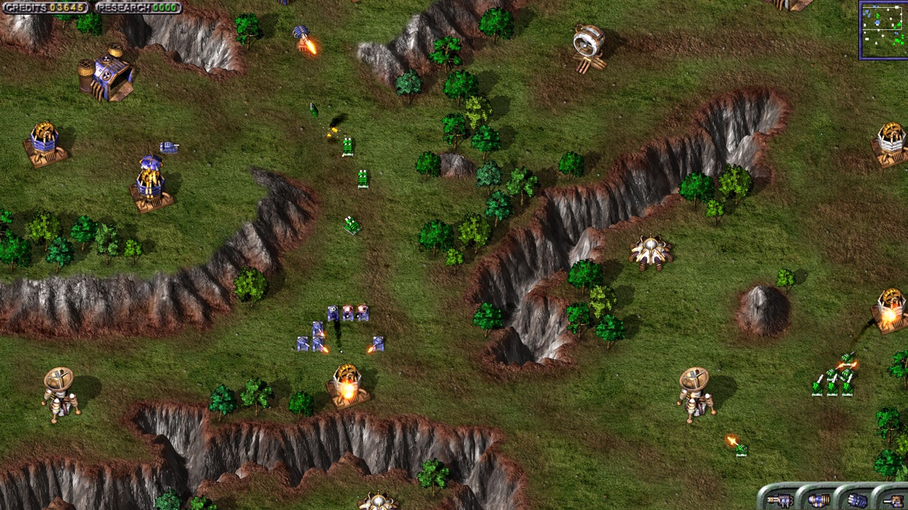
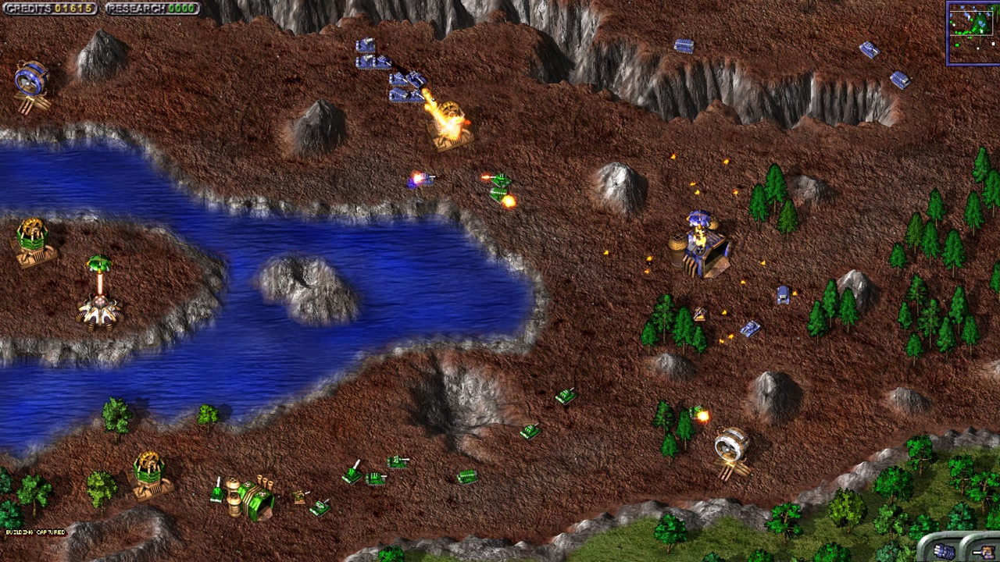
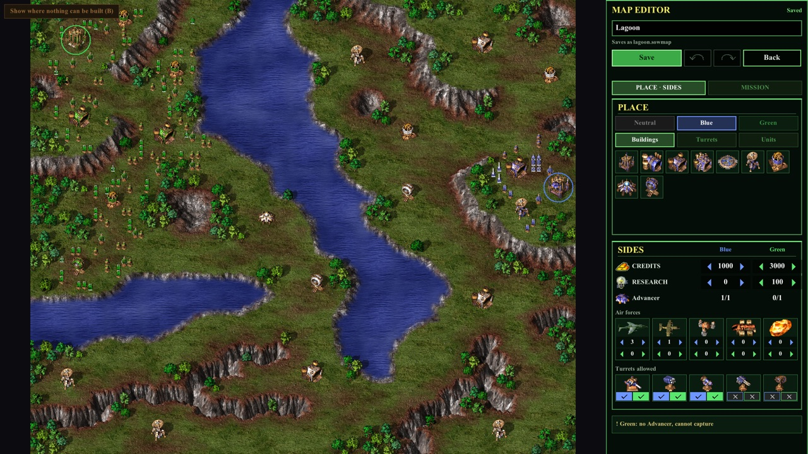
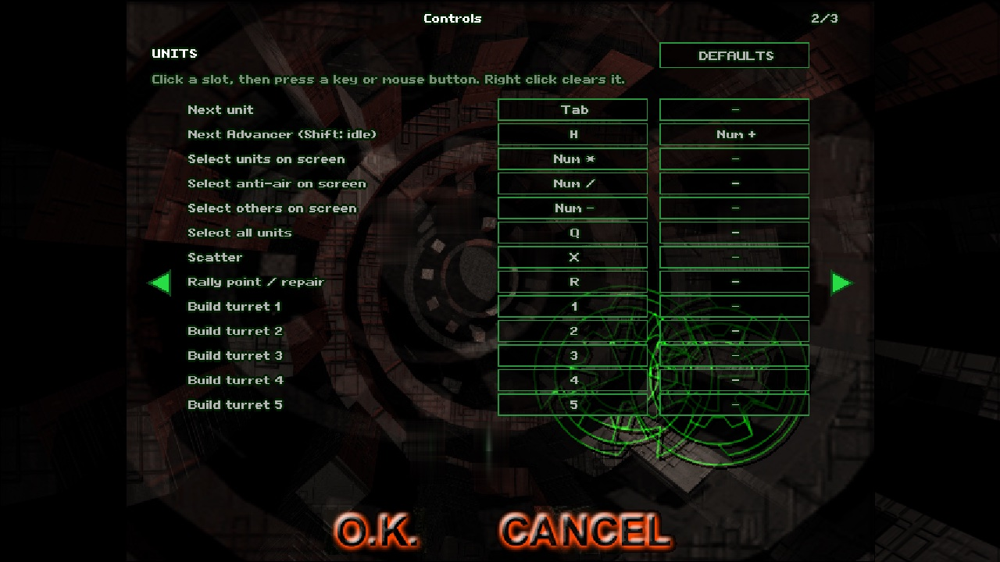

# OpenSOW

An open-source, cross-platform (macOS, Windows, Linux) reimplementation of **State of War**, the
2001 real-time strategy game, written in Rust.

[](https://github.com/sponsors/lukassolvar)



## Introduction

OpenSOW rebuilds the State of War engine so the game runs natively on today's machines, using the
data from your own copy.

- **Faithful to the original**: game rules, AI and file formats are decoded from the original
  executable, and savegames are written in the original format; every known deviation is
  documented in [docs/](docs/).
- **Runs everywhere**: native builds, any resolution up to 4K, no Wine.
- **Preserves and extends**: both campaigns in one game, plus skirmish, a map editor and optional
  enhancements.

### AI-assisted decompilation and rebuild

OpenSOW is built with AI coding agents. They disassemble the original executable, port each
routine to Rust, and verify the port by running the original code in an emulator and comparing the
results ([scripts/verify_against_exe.py](scripts/verify_against_exe.py)).

### Support the project

If you enjoy OpenSOW, support it through [GitHub Sponsors](https://github.com/sponsors/lukassolvar).
Even a small one-time donation is very much appreciated: it buys me a coffee to keep working on
these projects.

## Disclaimer

OpenSOW is an unofficial fan project, not affiliated with the original developers, publishers or
Steam. "State of War" is a trademark of its owners. **This repository and its releases contain no
game data**: you need your own copy of State of War (for example from Steam); Warmonger is
optional. OpenSOW is provided as is, without warranty.

## New features

### Both campaigns in one game

Switch between the State of War and Warmonger campaigns on the campaign map, each with its own
progress.


### Skirmish mode

Play against the computer on all 14 multiplayer maps of both games, or on your own maps.

- Set both sides' credits, research, air forces and turrets, or swap sides.
- Four computer levels: Easy, Normal, Hard and Brutal.
- The computer plays like a player: turrets, Advancer captures, carryall drops and air strikes.





#### Collecting stars

Earn stars by beating the computer on each map on Easy, Normal, Hard or Brutal.

### Map editor

Make your own skirmish maps and missions in the game:

- any of the game's terrains, with buildings, turrets and units for either side;
- win rules: destroy the enemy HQ, destroy everything, or **escort** a convoy to a goal;
- **timers**: hold out, time limit, or reinforcements;
- your maps appear on the skirmish screen's Custom tab.





### GPU drawing

The original draws every pixel on the processor. OpenSOW draws the frame on the graphics card
(Metal on macOS, Vulkan or DirectX 12 on Windows, Vulkan on Linux), so the game stays at a smooth
60 frames per second even on large 4K and 5K screens. The picture is pixel for pixel the same as
the processor's, and without a usable graphics card the game falls back to drawing on the
processor.

### Extra options

Optional enhancements, each with its own switch: sharper textures when zoomed in, soft shadows,
contact shadows under buildings and units, explosion glow, a shadow under every turret, better
sound, turret range while placing, and map zoom.


### Your own controls

Bind every hotkey to two keys or extra mouse buttons (middle, back, forward) in the Controls
menu, or swap the mouse buttons to give orders with the right click.



Also: resolutions up to 4K, five interface languages, and a launcher that finds your games, holds
the settings and updates itself.


## How to run

1. Download the file for your system from the
   [latest release](https://github.com/lukassolvar/opensow/releases/latest):
   - **macOS** (Apple silicon and Intel): `opensow-…-macos-universal.dmg`. Open it, drag **OpenSOW** to
     Applications and start it from there.
   - **Windows**: `opensow-…-windows-x86_64.zip`. Unpack it and start `OpenSOW\opensow-launcher.exe`.
   - **Linux**: `opensow-…-linux-x86_64.tar.gz` (or `linux-aarch64`). Unpack it and start
     `OpenSOW/opensow-launcher`.
2. The programs are not signed with a paid certificate yet. On macOS, if it says OpenSOW cannot be
   opened, click **Open Anyway** under System Settings → Privacy & Security (once). On Windows,
   choose **More info → Run anyway** if SmartScreen warns. The launcher updates itself afterwards.
3. Click **Find games automatically**: it looks in Steam's usual places on macOS, Linux and
   Windows, other Steam libraries included. If it finds nothing, click **Locate game…** and pick
   the `State of War` folder.
4. Press **Play**.

Controls: [docs/controls.md](docs/controls.md) and [docs/hotkeys.md](docs/hotkeys.md).

### Getting the game files on macOS and Linux

State of War is a Windows game, so Steam will not install it on macOS or Linux from the library.
If you own it on Steam, you can still download its files through the Steam console:

1. Start Steam and sign in with the account that owns State of War.
2. Open the console: paste `steam://open/console` into your web browser's address bar (or run
   `steam steam://open/console` in a terminal on Linux). A **Console** tab appears in Steam.
3. Type this into the console and press Enter:

   ```text
   download_depot 748040 748041
   ```

4. Wait for `Depot download complete`. The message shows where the files went. The folder has
   both games: `State of War` and, if you own it, `State of War Warmonger`.

| System | Download folder |
| --- | --- |
| macOS | `~/Library/Application Support/Steam/Steam.AppBundle/Steam/Contents/MacOS/steamapps/content/app_748040/depot_748041/` |
| Linux | `~/.local/share/Steam/steamapps/content/app_748040/depot_748041/` (also reachable as `~/.steam/steam/...`) |
| Linux (Flatpak Steam) | `~/.var/app/com.valvesoftware.Steam/.local/share/Steam/steamapps/content/app_748040/depot_748041/` |

**Find games automatically** in the launcher finds this folder; if it does not, click
**Locate game…** and pick the `State of War` folder, or set `OPENSOW_GAME_DIR` to it. Warmonger next to it is found
automatically.

Steam may remove the content folder when it cleans up, so you can move the `State of War` folder
(and `State of War Warmonger`) somewhere permanent, such as `~/Games/`, and point the launcher at
it.

Other ways to get the files:

- **Linux with Proton**: turn on Steam Play for State of War (Properties → Compatibility), install
  it from the library as usual; OpenSOW finds it under `steamapps/common/`.
- **A Windows PC**: install the game there and copy its install folder (the one with `Data`) to
  your Mac or Linux machine.

## How to install and develop

You need a stable Rust toolchain and your own install of State of War.

```bash
git clone https://github.com/lukassolvar/opensow.git
```

Set `OPENSOW_GAME_DIR` to your install (Steam installs are found automatically), then
run the launcher or the game:

```bash
cargo run --release -p opensow-launcher
```

```bash
cargo run --release -p opensow-game -- --windowed
```

Check that every file of your install parses (expect 0 failures):

```bash
cargo run --release -p opensow-tools -- check
```

The code is split into `crates/opensow-formats` (file formats and decoded game rules),
`opensow-viewer` (map drawing), `opensow-game`, `opensow-tools` and `opensow-launcher`. Start with
[docs/architecture.md](docs/architecture.md); the status is in [docs/roadmap.md](docs/roadmap.md).

## Contributing

Contributions are welcome. Read [CONTRIBUTING.md](CONTRIBUTING.md) first; above all, no game data
in the repository, and game behaviour comes from the original executable.

## Licence

MIT or [Apache 2.0](LICENSE-APACHE), at your option ([LICENSE-MIT](LICENSE-MIT)). This covers
OpenSOW's code only; the game's data stays the property of its owners.
