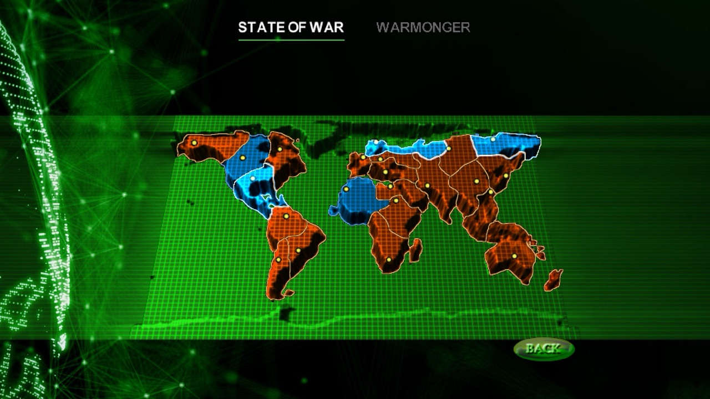
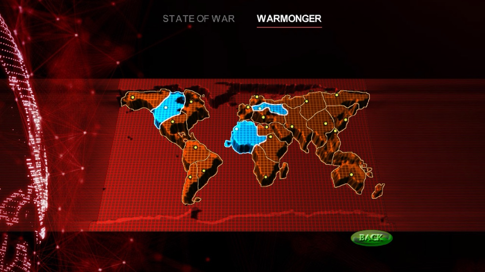
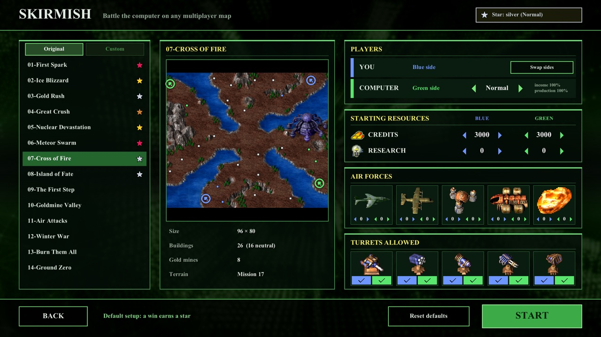
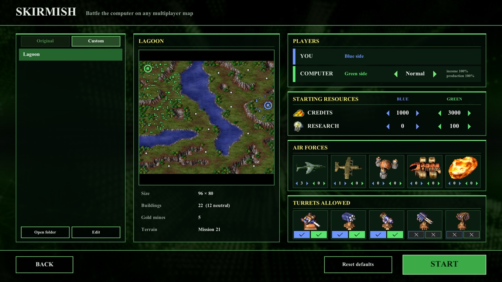
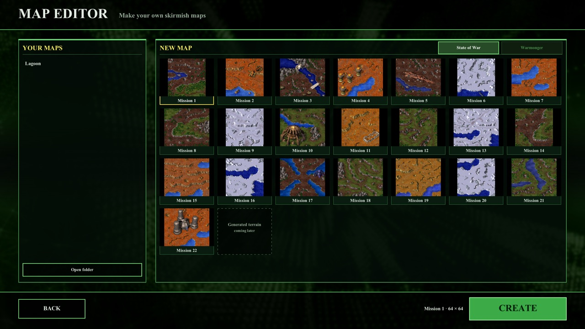
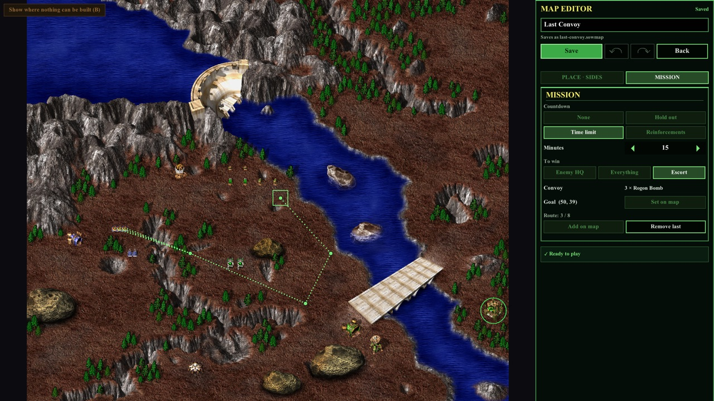
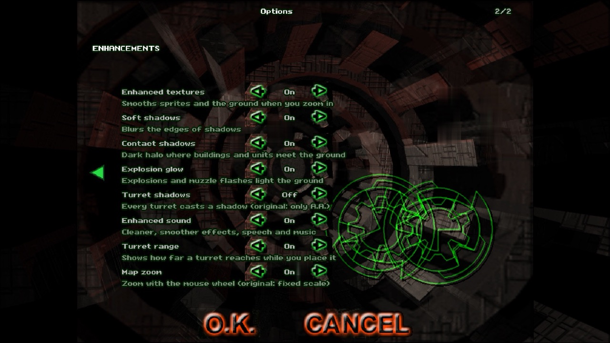
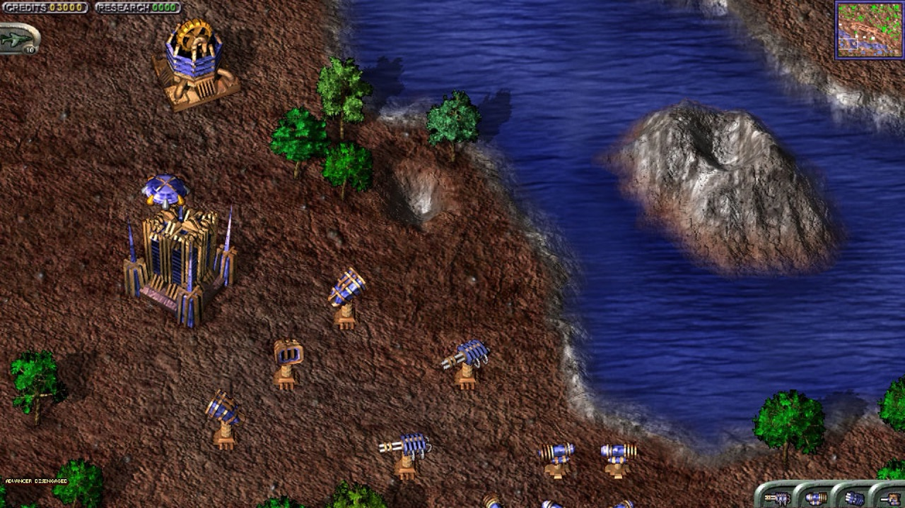
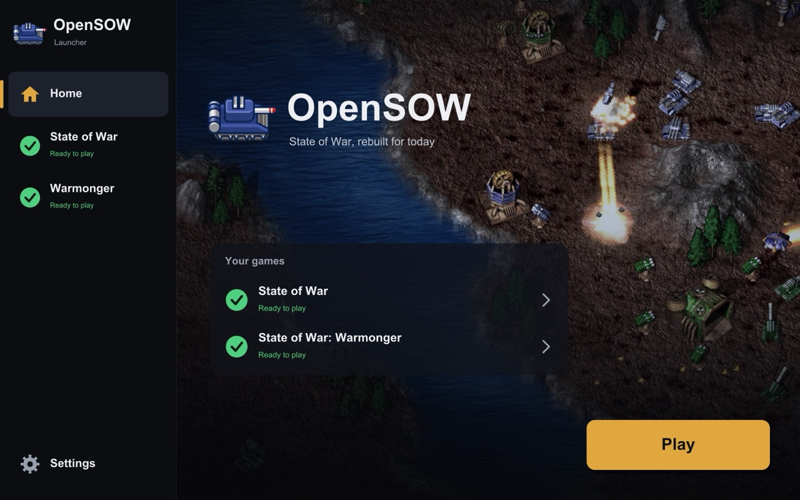

# OpenSOW

An open-source, cross-platform (macOS, Windows, Linux) reimplementation of **State of War**, the
2001 real-time strategy game, written in Rust.

[](https://github.com/sponsors/lukassolvar)


## Introduction

OpenSOW rebuilds the State of War engine so the game runs natively on today's machines, using the
data from your own copy.

- **Faithful to the original**: game rules, AI and file formats are decoded from the original
  executable; every known deviation is documented in [docs/](docs/).
- **Runs everywhere**: native builds, any resolution up to 4K, no Wine.
- **Preserves and extends**: both campaigns in one game, plus skirmish, a map editor and optional
  enhancements.

### AI-assisted decompilation and rebuild

OpenSOW is built with AI coding agents. They disassemble the original executable, port each
routine to Rust, and verify the port by running the original code in an emulator and comparing the
results ([scripts/verify_against_exe.py](scripts/verify_against_exe.py)).

### Support the project

If you enjoy OpenSOW, support it through [GitHub Sponsors](https://github.com/sponsors/lukassolvar).
Even a small one-time donation is very much appreciated: it buys me a coffee to keep working on
these projects.

## Disclaimer

OpenSOW is an unofficial fan project, not affiliated with the original developers, publishers or
Steam. "State of War" is a trademark of its owners. **This repository and its releases contain no
game data**: you need your own copy of State of War (for example from Steam); Warmonger is
optional. OpenSOW is provided as is, without warranty.

## New features

### Both campaigns in one game

Switch between the State of War and Warmonger campaigns on the campaign map, each with its own
progress.





### Skirmish mode

Play against the computer on all 14 multiplayer maps of both games, or on your own maps.

- Set both sides' credits, research, air forces and turrets, or swap sides.
- Four computer levels: Easy, Normal, Hard and Brutal.
- The computer plays like a player: turrets, Advancer captures, carryall drops and air strikes.






#### Collecting stars

Earn stars by beating the computer on each map on Easy, Normal, Hard or Brutal.

### Map editor

Make your own skirmish maps and missions in the game:

- any of the game's terrains, with buildings, turrets and units for either side;
- win rules: destroy the enemy HQ, destroy everything, or **escort** a convoy to a goal;
- **timers**: hold out, time limit, or reinforcements;
- your maps appear on the skirmish screen's Custom tab.






### Extra options

Optional enhancements: sharper textures when zoomed in, soft shadows, explosion glow, better
sound, turret range while placing, and map zoom.





Also: resolutions up to 4K, five interface languages, and a launcher that finds your games, holds
the settings and updates itself.



## How to run

1. Download the archive for your system from the
   [latest release](https://github.com/lukassolvar/opensow/releases/latest)
   (`macos-aarch64`, `macos-x86_64`, `windows-x86_64`, `linux-x86_64` or `linux-aarch64`).
2. Unpack it and start **opensow-launcher**.
3. If the launcher does not find your game, click **Locate game**.
4. Press **Play**.

Controls: [docs/controls.md](docs/controls.md) and [docs/hotkeys.md](docs/hotkeys.md).

## How to install and develop

You need a stable Rust toolchain and your own install of State of War.

```bash
git clone https://github.com/lukassolvar/opensow.git
```

Set `OPENSOW_GAME_DIR` to your install (on macOS the Steam location is found automatically), then
run the launcher or the game:

```bash
cargo run --release -p opensow-launcher
```

```bash
cargo run --release -p opensow-game -- --windowed
```

Check that every file of your install parses (expect 0 failures):

```bash
cargo run --release -p opensow-tools -- check
```

The code is split into `crates/opensow-formats` (file formats and decoded game rules),
`opensow-viewer` (map drawing), `opensow-game`, `opensow-tools` and `opensow-launcher`. Start with
[docs/architecture.md](docs/architecture.md); the status is in [docs/roadmap.md](docs/roadmap.md).

## Contributing

Contributions are welcome. Read [CONTRIBUTING.md](CONTRIBUTING.md) first; above all, no game data
in the repository, and game behaviour comes from the original executable.

## Licence

MIT or [Apache 2.0](LICENSE-APACHE), at your option ([LICENSE-MIT](LICENSE-MIT)). This covers
OpenSOW's code only; the game's data stays the property of its owners.
